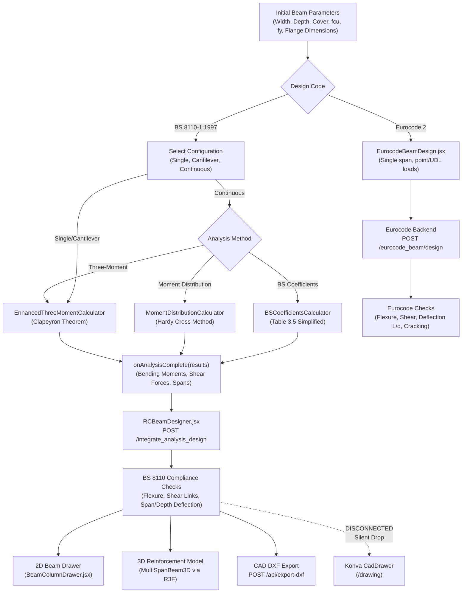
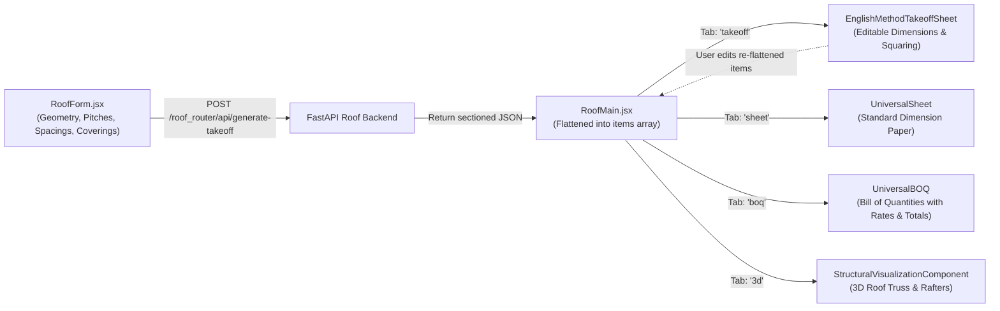
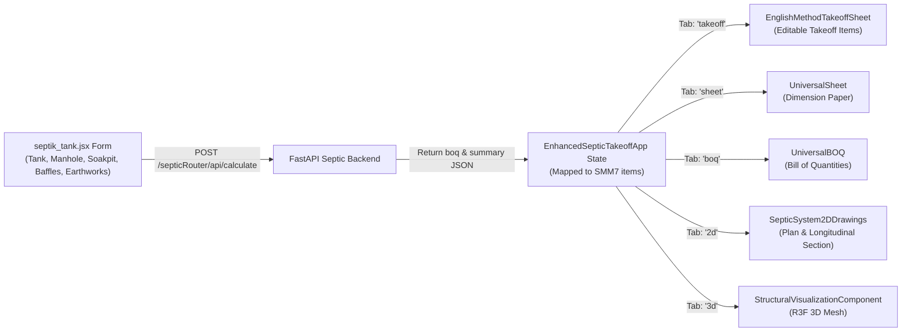
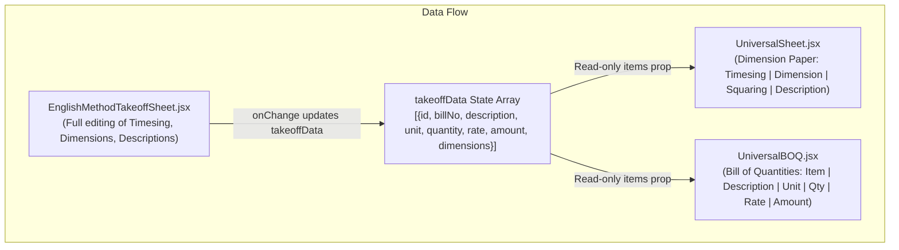
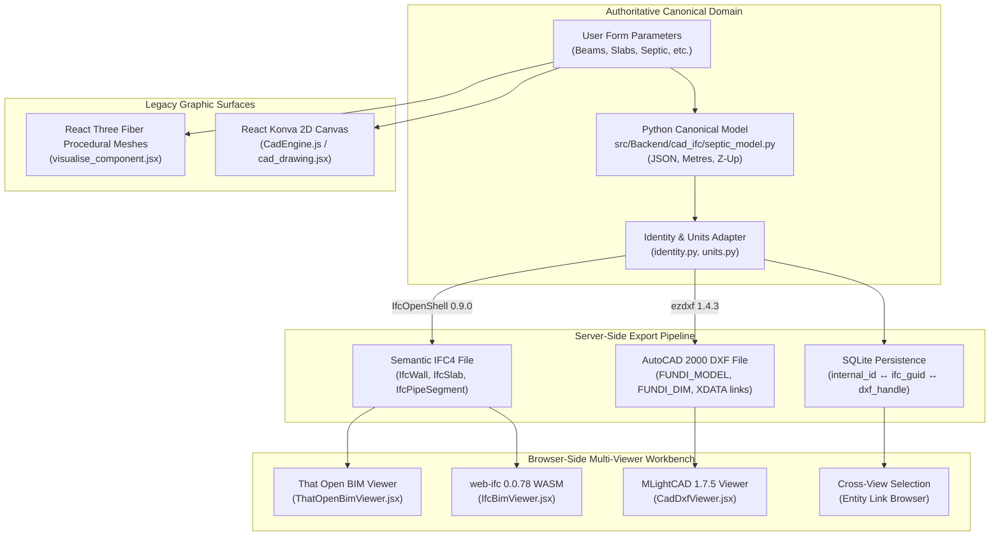

# Fundi Studio — UI/UX Architecture Audit and Engineering Workflow Mapping

**Repository Root:** `C:\Users\HP\Documents\programming\Java script\ReactApps\Services`  
**Active Feature Branch:** `feature/cad-bim-ifc-integration` (Tracking: `origin/feature/cad-bim-ifc-integration`)  
**Audit Date:** 2026-10-21  
**Scope:** Investigation, static code analysis, and architecture mapping across frontend (`src/`), backend (`src/Backend/`), and persistent storage layers.  
**Constraint Verification:** Zero application source code files modified.

---

## 1. Executive Summary of Current UI Architecture

Fundi Studio is an engineering web desktop application combining:
1. **Structural Engineering Design Suites:** Deterministic calculations for Reinforced Concrete (Beams, Columns, Slabs, Walls, Foundations, Stairs, Retaining Walls, Framed Buildings), Structural Steel (Universal Beams, Universal Columns, Bolted & Welded Connections), Structural Timber (BS 5268-2), and Structural Masonry (BS 5628-1).
2. **Quantity Surveying (QS) & Measurement:** Element-specific measurement tools (Roof, Septic Tank, Drainage, Swimming Pool, Basement, Finishes, Substructure, Superstructure) flowing into an English Method Taking-Off Sheet, Standard Dimension Paper, and Bills of Quantities (BOQ).
3. **Site Surveying & Geomatics:** Field levelling (Rise & Fall, Collimation), Traverse computation (Bowditch adjustment), Tacheometry, Sewer gradient calculations, Earthworks volume estimation, GNSS/Geoid modeling, Road/Railway alignment, Utilities, and Deformation monitoring.
4. **Geotechnical / Soil Mechanics:** Phase relations, Atterberg limits, Proctor compaction, Direct shear/triaxial, Terzaghi/Meyerhof bearing capacity, 1D consolidation, Bishop slope stability, and 3D borehole/soil stratigraphic visualization.
5. **CAD & BIM Interoperability:** Dual-track CAD/BIM infrastructure:
   - *Legacy Track:* React Konva 2D canvas (`CadEngine`) and React Three Fiber (R3F) procedural mesh viewers.
   - *New Interoperability Track:* Isolated `/interop/cad-bim` workbench integrating `@mlightcad/*` 1.7.5 (DWG/DXF rendering/editing), `web-ifc` 0.0.78 (client-side IFC parsing), and server-side Python `IfcOpenShell` 0.9.0 + `ezdxf` 1.4.3 generating semantic IFC4 models with SQLite-backed persistent identity mapping.
6. **Chat & Agent Workspace:** A floating chat bar and slide-over conversation drawer backed by a local streaming LLM endpoint (`/qwen_model/generate_stream`).

### Key Architectural Findings & Real-World Disconnects
- **Routing & State Fragmentation:** Most engineering modules manage state via isolated `useState` hooks within individual component trees. The root `AppLayout` holds a top-level `takeoffData` array, but individual specialized takeoff modules (such as `RoofComponent` and `EnhancedSepticTakeoffApp`) maintain their own private `takeoffData` states and do not automatically sync with the global Taking-Off / BOQ routes.
- **Port Discrepancies:** While the main FastAPI backend runs on port `8001` (serving routers for RC beams, takeoff, timber, masonry, and CAD/IFC), several legacy components (e.g. `SoilMechanicsModule` and `cad_drawing.jsx` AI copilot) still target `http://localhost:8000`, causing network failures if not multiplexed.
- **"Send to CAD" Disconnect:** The BS 8110 Beam Designer (`RCBeamDesigner.jsx`) executes a `navigate("/drawing", { state: { config: ... } })`, but the destination 2D CAD component (`CadDrawer.jsx`) does not import or inspect `useLocation().state`, silently discarding the passed reinforcement drawing configuration.
- **Disabled Streaming AI Route:** The root chat interface requests `http://127.0.0.1:8001/qwen_model/generate_stream`, but in `src/Backend/main.py`, line 286 (`#app.include_router(qwen_model_router...)`) is commented out, causing the assistant to consistently report "Fundi service unavailable."

---

## 2. Actual Application Structure and Key Entry Points

```
Services/
├── package.json                          # React 19.0.0, react-scripts 5.0.1, Three.js 0.172.0, @mlightcad/*
├── public/
│   ├── web-ifc/web-ifc.wasm              # Client-side WASM engine for IFC parsing
│   └── index.html
├── src/
│   ├── index.js                          # Root DOM mounting (React 19 createRoot)
│   ├── App.js                            # Mounts <EngineeringApp />
│   ├── components/
│   │   ├── engineering_appp.jsx          # Central application shell, routing table, theme, chat overlay
│   │   ├── components/
│   │   │   ├── Sidebar.jsx               # Left navigation drawer (5 primary routes)
│   │   │   ├── RightSidebar.jsx          # Settings drawer (Theme toggle, preferences)
│   │   │   └── ChatPage.jsx              # Home dashboard & 34-tool categorized launcher directory
│   │   ├── ReinforcedConcrete/           # Beams, Columns, Slabs, Walls, Foundations, Retaining, Stairs
│   │   ├── SteelDesign/                  # BS 5950 Member design, Connections, 2D/3D Builder
│   │   ├── Timber/                       # BS 5268-2 Flexure, Compression, Combined, Stud Wall
│   │   ├── masonry/                      # BS 5628-1 Vertical Wall & Lateral Panel design
│   │   ├── takeoff2/                     # Specialized takeoffs, EnglishMethodTakeoffSheet, Universal BOQ
│   │   ├── Surveying/                    # Levelling, Traverse, Setting-out, Earthworks, Monitoring, GNSS
│   │   ├── Soil_mechanics/               # Geotechnical tests, bearing capacity, slope stability, 3D profile
│   │   ├── Drawings/                     # Konva 2D CadDrawer, R3F visualise_component
│   │   └── interop/                      # MLightCAD + web-ifc + That Open CAD/BIM/IFC Workbench
│   └── Backend/                          # FastAPI application
│       ├── main.py                       # Root FastAPI app mounting ~30 calculation routers on port 8001
│       ├── cad_ifc/                      # Canonical model, identity, units, IFC4/DXF export, SQLite mapping
│       ├── calculations/                 # Engineering calculation packages (RC, Steel, Timber, Masonry, QS)
│       └── Databases/                    # SQLite / SQLAlchemy persistence setup
```

### Entry Point Trace
1. `src/index.js` mounts `<App />` using React 19 `createRoot`.
2. `src/App.js` renders `<EngineeringApp />` from `src/components/engineering_appp.jsx`.
3. `src/components/engineering_appp.jsx` initializes:
   - `BrowserRouter` (`react-router-dom` 7.5.0).
   - Global theme state `isDark` and toggling mechanism.
   - Global layout shell `<AppLayout>` wrapping top navigation, search/query bar, left and right sidebars, chat modal, and main `<Routes>`.

---

## 3. Route and Navigation Inventory

| Path | Component File | Menu / Source | Implemented Status | Verification Notes |
|---|---|---|---|---|
| `/` | `src/components/components/ChatPage.jsx` | Sidebar "Home", Top Nav House | Confirmed Implemented | Home hub, tool cards, tool search modal |
| `/structural/manual/beam` | `src/components/ReinforcedConcrete/Beams/StructuralEngineeeringSuite.jsx` | Sidebar "Structural design", ChatPage | Confirmed Implemented | BS 8110 & Eurocode 2 multi-span beam pipeline |
| `/structural/manual/column` | `src/components/ReinforcedConcrete/Columns/Columnmain.jsx` | ChatPage | Confirmed Implemented | Uniaxial & biaxial column design + interaction chart |
| `/structural/manual/stairs` | `src/components/ReinforcedConcrete/Stairs/stair_main_app.jsx` | ChatPage | Confirmed Implemented | Doglegged / straight flight RC stairs |
| `/structural/manual/retaining` | `src/components/ReinforcedConcrete/Rwall/main_app_component.jsx` | ChatPage | Confirmed Implemented | Cantilever & gravity retaining walls |
| `/structural/manual/foundation` | `src/components/ReinforcedConcrete/Foundations/foundation_main_app.jsx` | ChatPage | Confirmed Implemented | Pad, combined, pile caps, strip footings |
| `/structural/manual/wall` | `src/components/ReinforcedConcrete/Walls/main_wall_app.jsx` | ChatPage | Confirmed Implemented | Shear walls and plain/reinforced bearing walls |
| `/structural/manual/slabs` | `src/components/ReinforcedConcrete/Slabs/main_slab_app.jsx` | ChatPage | Confirmed Implemented | BS 8110 / Eurocode 2 one-way, two-way, ribbed slabs |
| `/structural/manual/eurocode_structural_app` | `src/components/ReinforcedConcrete/FramedandTall/eurocode_structural_app.jsx` | ChatPage | Confirmed Implemented | Multi-story tall building analysis & frame modeling |
| `/structural/manual/steel` | `src/components/SteelDesign/steel_design_app.jsx` | ChatPage | Confirmed Implemented | BS 5950 member design + frame analysis + 3D builder |
| `/structural/automatic/bolt_connections` | `src/components/SteelDesign/bolted_connections_frontend.jsx` | ChatPage | Confirmed Implemented | Ordinary bolts, HSFG, bolt groups |
| `/structural/automatic/weld_connections` | `src/components/SteelDesign/welded_joints_frontend.jsx` | ChatPage | Confirmed Implemented | Fillet, butt, lap, and tee joints |
| `/structural/manual/Timber_design` | `src/components/Timber/Timber_ui.jsx` | ChatPage | Confirmed Implemented | BS 5268-2 Flexure, Axial, Combined, Stud wall |
| `/structural/manual/Masonry_design` | `src/components/masonry/Masonry_ui.jsx` | ChatPage | Confirmed Implemented | BS 5628-1 Vertical Wall & Lateral Panel design |
| `/quantity/manual/taking-off` | `src/components/engineering_appp.jsx` (`QuantityTakeoffWrapper`) | Sidebar "Quantity & surveying", ChatPage | Confirmed Implemented | English method taking-off sheet editor |
| `/quantity/manual/approximate` | `src/components/engineering_appp.jsx` (`ApproximateQuantitiesWrapper`) | Direct wrapper nav, ChatPage | Confirmed Implemented | Standard dimension paper sheet |
| `/quantity/manual/boq` | `src/components/engineering_appp.jsx` (`BOQWrapper`) | Direct wrapper nav, ChatPage | Confirmed Implemented | Bill of quantities generator |
| `/quantity/manual/documents` | `src/components/takeoff2/DocumentViewer.jsx` | Direct wrapper nav, ChatPage | Confirmed Implemented | Document attachment and viewer |
| `/quantity/manual/roof-taking-off` | `src/components/takeoff2/RoofWorks/RoofMain.jsx` | ChatPage | Confirmed Implemented | Roof geometry form, 3D visualizer, SMM7 takeoff, BOQ |
| `/quantity/manual/septic-taking-off` | `src/components/takeoff2/septik/septik_tank.jsx` | ChatPage | Confirmed Implemented | Septic tank, manhole, soakpit takeoff & 2D/3D views |
| `/quantity/manual/drainage-taking-off` | `src/components/takeoff2/Manhole/MainTakeoff.jsx` | ChatPage | Confirmed Implemented | Manholes, trenching, sewer pipes |
| `/quantity/manual/external-taking-off` | `src/components/takeoff2/ExternalWorks/MainExternalWorks.jsx` | ChatPage | Confirmed Implemented | Paving, kerbs, fences, site clearance |
| `/quantity/manual/swimming-pool-taking-off` | `src/components/takeoff2/swimming/swimming_pool.jsx` | ChatPage | Confirmed Implemented | Excavation, reinforced lining, finishes |
| `/quantity/manual/basement-taking-off` | `src/components/takeoff2/Basement_Takeoff.jsx` | ChatPage | Confirmed Implemented | Earth retention, waterproofing, concrete |
| `/quantity/manual/rcc-superstructure` | `src/components/takeoff2/superstructure.jsx` | ChatPage | Confirmed Implemented | Beams, columns, and floor slabs takeoff |
| `/quantity/manual/door_window` | `src/components/takeoff2/Door_Window/Doors&Window.jsx` | ChatPage | Confirmed Implemented | Door and window schedules and takeoff |
| `/quantity/manual/internal_finishes` | `src/components/takeoff2/Internal_Finishes/internal_finishes.jsx` | ChatPage | Confirmed Implemented | Plastering, painting, tiling, screeding |
| `/quantity/manual/electrical_plumbing` | `src/components/takeoff2/Electrical_Plumbing/ElectricalPlumbingTakeoff.jsx` | ChatPage | Confirmed Implemented | Conduits, wiring, pipes, sanitary fixtures |
| `/quantity/manual/superstructure-takeoff` | `src/components/takeoff2/Superstructure/Superstructure_takeoff.jsx` | ChatPage | Confirmed Implemented | General superstructure works |
| `/quantity/manual/Underground_tank` | `src/components/takeoff2/underground_tank.jsx` | ChatPage | Confirmed Implemented | Underground water storage tank |
| `/quantity/manual/substructure_works` | `src/components/takeoff2/SubStrucure_works/substructure_works.jsx` | ChatPage | Confirmed Implemented | Foundation trenching, hardcore, DPC, footings |
| `/quantity/manual/staircase_takeoff` | `src/components/takeoff2/Stairs/Enhanced_Stairs.jsx` | ChatPage | Confirmed Implemented | Concrete steps, waist, stringers, handrails |
| `/surveying` | `src/components/Surveying/surveying_app.jsx` | ChatPage | Confirmed Implemented | Levelling, Traverse, Tacheometry, Sewer, Control |
| `/surveying/geoid-model` | `src/components/Surveying/Geoid_model/geoid_model.jsx` | ChatPage | Confirmed Implemented | GNSS geoid height corrections |
| `/surveying/road-railway` | `src/components/Surveying/Road_Railway/main_road.jsx` | ChatPage | Confirmed Implemented | Horizontal/vertical curves, transition spirals |
| `/surveying/utilities` | `src/components/Surveying/Utilities/Utilities_infrastructure.jsx` | ChatPage | Confirmed Implemented | Pipeline, power line, water network routing |
| `/surveying/earthworks` | `src/components/Surveying/Earthworks/erathworks.jsx` | ChatPage | Confirmed Implemented | Cut & fill volumes, cross-sections, mass haul |
| `/surveying/setting-out` | `src/components/Surveying/Setting_&_construction/surveying_dashboard.jsx` | ChatPage | Confirmed Implemented | Curve offsets, batter boards, building grid lines |
| `/surveying/contouring` | `src/components/Surveying/Contouring/Contouring_terrain.jsx` | ChatPage | Confirmed Implemented | Delaunay triangulation, TIN, digital elevation |
| `/surveying/monitoring` | `src/components/Surveying/Deformation_&_Monitoring/monitoring_deformation.jsx` | ChatPage | Confirmed Implemented | Structural movement, settlement, tilt tracking |
| `/surveying/soil-mechanics` | `src/components/Soil_mechanics/soil_mechanics.jsx` | ChatPage | Confirmed Implemented | 10 geotechnical calculation & test modules |
| `/drawing` | `src/components/Drawings/cad_drawing.jsx` | Sidebar "CAD & 3D", ChatPage | Confirmed Implemented | React Konva 2D CAD drafting environment |
| `/visualise` | `src/components/Drawings/visualise_component.jsx` | ChatPage | Confirmed Implemented | R3F 3D visualization and component inspector |
| `/interop/cad-bim` | `src/components/interop/InteropWorkbench.jsx` | Sidebar "CAD / BIM / IFC", ChatPage | Confirmed Implemented | MLightCAD + That Open + web-ifc workbench |
| `/drawing/roads` | `src/components/Drawing_Components/Roads/RoadApp.jsx` | ChatPage | Confirmed Implemented | Interactive 2D road cross-section drafter |
| `/drawing/columns_beams` | `src/components/Drawing_Components/Columns_Beams/ColumnsBeamsApp.jsx` | ChatPage | Confirmed Implemented | 2D structural framing and grid layout tool |
| `/drawing/roof_structure` | `src/components/Drawing_Components/roof-structure/index.jsx` | ChatPage | Confirmed Implemented | 2D roof truss drafting and details |
| `/drawing/slabs` | `src/components/Drawing_Components/slabs/SlabModule.jsx` | ChatPage | Confirmed Implemented | 2D slab rebar arrangement drafter |
| `/drawing/dimensions` | `src/components/Drawing_Components/Dimensions/App.jsx` | ChatPage | Confirmed Implemented | Drawing dimensioning and annotation tool |
| `/drawing/materials` | `src/components/Drawing_Components/Materials/App.jsx` | ChatPage | Confirmed Implemented | Hatching patterns and architectural materials |
| `/drawing/electrical` | `src/components/electrical/ElectricalApp.jsx` | ChatPage | Confirmed Implemented | Electrical schematic and circuit layout |
| `/drawing/plumbing` | `src/components/plumbing/PlumbingApp.jsx` | ChatPage | Confirmed Implemented | Plumbing schematics and drainage layouts |

---

## 4. Component and Layout Inventory

### Application Shell Layout (`AppLayout`)
- **Top Navigation Bar:** Fixed header (`z-40`) providing Fundi brand icon, hamburger button (opens Left Navigation Drawer), Home button (`/`), centered floating Query/Chat input bar (visible on all pages except `/`), and Settings gear button (opens Right Settings Drawer).
- **Left Navigation Drawer (`Sidebar.jsx`):** Modal slide-out drawer (`z-50`) displaying 5 high-level navigation destinations: Home (`/`), Structural design (`/structural/manual/beam`), Quantity & surveying (`/quantity/manual/taking-off`), CAD & 3D (`/drawing`), and CAD / BIM / IFC (`/interop/cad-bim`), accompanied by a mock recent activity history list.
- **Right Settings Drawer (`RightSidebar.jsx`):** Modal slide-out drawer (`z-[70]`) with dark/light mode toggle and placeholders for account preferences and notifications.
- **Main Viewport (`<main>`):** Scrollable container with responsive top padding (`pt-32 sm:pt-24` on sub-routes, `pt-0` on `/`).
- **Footer Strip:** Fixed bottom bar (`z-30`) displaying suite version (`Fundi Engineering Suite v2.0`) and copyright.

---

## 5. Structural Design Input & Output Audit

### A. Reinforced Concrete Beam Design Pipeline



#### Detailed Stage Breakdown:
1. **Initial Inputs:**
   - *File:* `src/components/ReinforcedConcrete/Beams/StructuralEngineeeringSuite.jsx`
   - *Code selector:* BS 8110 vs. Eurocode 2 (toggle).
   - *Section geometry:* Rectangular (`width`, `depth`), T-Beam / L-Beam (`web_width`, `depth`, `flange_width`, `flange_thickness`).
   - *Materials:* Concrete characteristic cube strength $f_{cu}$ (20, 25, 30, 35, 40, 45, 50 N/mm²), steel yield strength $f_y$ (250, 460 N/mm²).
   - *Durability & Fire:* Exposure condition (`Mild`, `Moderate`, `Severe`, `Very Severe`, `Extreme`), Nominal cover $c$ (mm), Fire resistance period (`30 mins` to `4 hours`).
2. **Analysis Execution:**
   - Continuous beams provide 3 selectable analysis engines:
     1. `Three.jsx` (`EnhancedThreeMomentCalculator`): Solves Clapeyron's continuous three-moment equations for variable spans and loads.
     2. `distribution.jsx` (`MomentDistributionCalculator`): Iterative Hardy Cross distribution table with fixed-end moments, stiffness factors, and carryover.
     3. `BSCoefficientsCalculator.jsx`: Code coefficient lookup from BS 8110 Table 3.5 for equal spans and uniformly distributed loads.
3. **Design Engine Integration:**
   - *File:* `src/components/ReinforcedConcrete/Beams/RCBeamDesigner.jsx`
   - Invokes backend endpoints:
     - `POST http://localhost:8001/beam_analysis/rc_design/integrate_analysis_design`
     - Or `POST http://localhost:8001/beam_analysis/rc_design/integrated/moment_distribution_design`
   - Performs tension steel sizing ($A_{s,req}$, bar count, bar diameter), compression reinforcement calculation ($A_{s,req}'$), shear link diameter & spacing ($s_v \le 0.75d$), and modified span-to-effective-depth ratio serviceability deflection check.
4. **Visual & Drawing Artifacts:**
   - **2D Section Details:** Rendered inline via `BeamColumnDrawer.jsx` (Konva cross-section showing main rebar, compression steel, and stirrup ties).
   - **3D Interactive Model:** Rendered via `Beam_THree.jsx` (`MultiSpanBeam3D`), displaying 3D rebar cages inside a semi-transparent concrete bounding box.
   - **DXF CAD Export:** Calls `POST http://localhost:8001/api/export-dxf`, returning an AutoCAD `.dxf` file containing longitudinal elevations and sections.
   - **Routing Disconnect Found:** Clicking "Send to CAD" executes `navigate("/drawing", { state: { config: get2DConfig(span, idx) } })`. However, `src/components/Drawings/cad_drawing.jsx` does not consume `location.state`, causing the sent geometry to be lost upon navigation.

---

### B. Reinforced Concrete Slab Design Pipeline
- **Component:** `src/components/ReinforcedConcrete/Slabs/main_slab_app.jsx` (wrapper for `slab_calculator_frontend.jsx` and `eurocode_slab_calculator.jsx`).
- **Input Parameters:**
  - Slab Type: `one-way`, `two-way`, `ribbed`, `waffle`.
  - Span Conditions: `single`, `continuous`, `cantilever`.
  - Support: `simply-supported`, `continuous`.
  - Dimensions: One-way (`spanLength`, `slabWidth`), Two-way ($l_x$, $l_y$, edge continuity condition), Cantilever (`cantileverLength`, `backspanLength`), Ribbed (`ribWidth`, `ribSpacing`, `topping`, `ribDepth`).
  - Loading: Dead load ($G_k$ in kN/m²), Imposed load ($Q_k$ in kN/m²).
  - Materials: $f_{ck}$ (MPa), $f_y$ (MPa), exposure class, max aggregate size, fire rating.
- **Calculation Execution:**
  - Calls `POST http://localhost:8001/slab_backend/api/calculate`.
  - *Orphan Code Detected:* `slab_calculator_frontend.jsx:96-218` contains an in-memory BS 8110 calculation function `calculateMockResults()` that computes bending moments, effective depths, and steel areas directly in JavaScript. However, the UI submit handler `calculateSlab()` only calls the backend API and catches errors without falling back to this function, leaving it dead code.
- **Outputs & Artifacts:**
  - Detailed reinforcement schedules for short-span and long-span bottom/top steel.
  - 2D section/plan drawer (`SlabDrawer.jsx`).
  - 3D slab visualization (`slab_THReeD.jsx`).

---

### C. Structural Steel Design Pipeline
- **Components:** `src/components/SteelDesign/steel_design_app.jsx`, `bolted_connections_frontend.jsx`, `welded_joints_frontend.jsx`.
- **BS 5950 Member Design:**
  - *Universal Beams (UB):* Section database containing 20 UK standard designations (from `127x76x13` to `914x419x388`) with cross-sectional area, moments of inertia ($I_x, I_y$), elastic moduli ($Z_x, Z_y$), and radii of gyration ($r_x, r_y$).
  - *Universal Columns (UC):* Section database with 15 standard designations (from `152x152x23` to `356x406x634`).
  - *Steel Grades:* S275 ($f_y = 275$), S355 ($f_y = 355$), S450 ($f_y = 450$ N/mm²).
  - *Calculation Execution:* Member design (`calculateBeamDesign` and `calculateColumnDesign`) runs **entirely on the client in JavaScript**. Checks flange/web slenderness classification (Plastic, Compact, Semi-compact, Slender), moment capacity $M_c$, shear capacity $P_v$, lateral torsional buckling resistance $M_b$, deflection $\delta_{max} \le L/360$, and column axial-bending interaction ($P/P_c + M_x/M_{cx} + M_y/M_{cy} \le 1.0$).
- **Frame Analysis:**
  - Calls backend `POST http://localhost:8001/steel_backend/api/frame-analysis` with spans and support boundary conditions, returning moment and shear envelope arrays.
- **Connection Modules:**
  - Bolted connections call `POST http://localhost:8001/api/bolted-connections/ordinary-bolts`.
  - Welded joints call `POST http://localhost:8001/api/welded-joints/fillet-weld`.
- **Steel BIM & 3D:** Integrated `SteelStructureBuilderWrapper.jsx` and `SteelBIM.jsx` provide parametric 3D structural steel framing grids.

---

### D. Timber Design Pipeline
- **Component:** `src/components/Timber/Timber_ui.jsx`.
- **Standard:** BS 5268-2:2002 (Structural use of timber — Code of practice for permissible stress design).
- **Modules / Tabs:**
  1. `Flexural Member`: Bending stress, shear stress, total deflection (bending + shear strain), bearing stress.
  2. `Compression — Axial`: Column slenderness ratio $\lambda = L_e/r \le 250$, permissible axial stress $K_3 \cdot K_{12} \cdot \sigma_{c,adm}$.
  3. `Compression — Combined`: Axial compression + lateral bending unity interaction check.
  4. `Stud Wall`: Stud axial load capacity with sheathing restraint and lateral wind pressure.
- **Inputs & Parameters:**
  - Strength classes: 16 classes (C14 to C40 softwood, D30 to D70 hardwood).
  - Service classes: 1 (internal heated), 2 (unheated covered), 3 (external exposed).
  - Load duration: Long term ($K_3 = 1.0$), Medium term ($K_3 = 1.25$), Short term ($K_3 = 1.5$), Very short term ($K_3 = 1.75$).
  - Geometric dimensions: Breadth $b$, depth $h$, span, bearing length.
- **Execution & Endpoints:**
  - Calls `POST http://localhost:8001/design/flexural-member`, `/design/compression-axial`, `/design/compression-combined`, `/design/stud-wall` via Axios.
- **Artifacts:**
  - Dedicated blueprint-style 2D canvas visualizer in `Timber_visualisation.jsx` rendering grain hatching, neutral axis, and dimension leader lines.

---

### E. Masonry Design Pipeline
- **Component:** `src/components/masonry/Masonry_ui.jsx`.
- **Standard:** BS 5628-1:2005 (Code of practice for use of masonry — Structural use of unreinforced masonry).
- **Modules / Tabs:**
  1. `Vertical Wall Design`: Single leaf or cavity wall clear height, thickness, eccentricity ($0.05t$ to $0.3t$), construction control category (Normal/Special), characteristic compressive strength $f_k$, capacity reduction factor $\beta$, design vertical load resistance $N_{Rd} = \beta t f_k / \gamma_m$.
  2. `Lateral Panel Design`: Orthogonal ratio $\mu$, bending moment coefficients $\alpha$, flexural strength parallel $f_{kx,par}$ and perpendicular $f_{kx,perp}$ to bed joints, moment resistances $M_{k,par}$ and $M_{k,perp}$.
- **Execution & Endpoints:**
  - Calls `POST http://localhost:8001/design/vertical_wall` and `POST http://localhost:8001/design/lateral_panel`.
- **Artifacts:**
  - Toggleable Konva canvas in `masonry_visualiser.jsx` showing elevation, brick coursing, wall ties, and stress gauges.

---

## 6. Quantity Surveying — Workflows & Form Layouts

### A. Roof Work Takeoff Pipeline



#### Roof Input Form Audit (`RoofForm.jsx`):
- **Form Structure:**
  - *Roof Type:* Dropdown (`gable`, `hipped`, `gambrel`, `lean-to`, `mansard`).
  - *Building Dimensions:* Length (m), Width (m), Wall thickness (m), Eaves overhang (m).
  - *Pitch Controls:* Lower pitch angle ($5^\circ$ to $80^\circ$ slider). For Gambrel/Mansard types, conditionally reveals Upper pitch angle ($5^\circ$ to $45^\circ$) and Break position ratio slider ($0.2$ to $0.8$).
  - *Framing Specifications:* Truss spacing (m), Rafter spacing (m), Timber section sizes (Wall plate, Rafter, Tie beam, Strut, Ridge board, Purlin).
  - *Covering & Drainage:* Tiles, metal sheets, shingles; toggle for rainwater goods (gutters/downpipes).
- **Takeoff Generation:**
  - Calls `POST http://localhost:8001/roof_router/api/generate-takeoff`.
  - Backend returns bill sections: Excavation/Wall plates, Rafters, Struts, Ties, Ridge, Covering, Rainwater goods.
  - Automatically switches view to `EnglishMethodTakeoffSheet`.

---

### B. Septic Tank Takeoff Pipeline



#### Septic Tank Input Form Audit (`septik_tank.jsx`):
- **Form Groupings:**
  1. *Septic Tank Chamber:* Internal length, width, depth (m), wall thickness, base slab thickness, cover slab thickness, floor slope.
  2. *Baffle Walls:* Number of baffles ($0$ to $4$), length, thickness, and dynamic individual baffle height inputs ($H_1, H_2, \dots$).
  3. *Inspection Manholes:* Internal length, width, depth, base thickness, cover length/width, cover count.
  4. *Soak Pit / Absorption Pit:* Shape (`circular` vs. `rectangular`), diameter/width, depth, honeycombed wall thickness.
  5. *Excavation & Soils:* Vegetable soil stripping depth, working space allowance, cover soil backfill depth.
- **Generation & Propagation:**
  - Calls `POST http://localhost:8001/septicRouter/api/calculate`.
  - Maps response rows into `{ id, billNo, itemNo, description, unit, quantity, rate, amount, dimensions }`.
  - Automatically activates the `takeoff` editor tab.

---

### C. Taking-Off → Dimension Paper → BOQ Data Propagation



- **Propagation Logic:**
  - In `RoofMain.jsx` and `septik_tank.jsx`, items are maintained in local component state.
  - User edits in `EnglishMethodTakeoffSheet` fire `onChange(takeoffItems)`, propagating immediately to `UniversalSheet` and `UniversalBOQ`.
  - *Data Consistency:* Changes in timesing or dimensions inside `EnglishMethodTakeoffSheet` recalculate the squaring and update item quantity, which immediately reflects in the BOQ total column.
  - *Limitation:* The standalone global routes (`/quantity/manual/taking-off`, `/quantity/manual/approximate`, `/quantity/manual/boq`) read from `AppLayout`'s isolated `takeoffData` state. Specialized tool runs do not automatically register in global state unless manually transferred.

---

## 7. Surveying Form and Workflow Inventory

All surveying modules are unified under `src/components/Surveying/`:

| Module | Route / Component | Primary Inputs | Output & Calculations |
|---|---|---|---|
| **Levelling** | `/surveying` (`LevellingModule`) | Benchmark RL, BS (Backsight), IS (Intermediate sight), FS (Foresight) table rows | Rise & Fall and Height of Collimation (HPC); arithmetic checks: $\sum BS - \sum FS = \sum Rise - \sum Fall = Last RL - First RL$ |
| **Traverse** | `/surveying` (`TraverseModule`) | Station coordinates, whole circle bearings (WCB), measured lengths | Latitudes $\Delta N = L \cos \theta$, Departures $\Delta E = L \sin \theta$; Bowditch / Transit rule angular and linear closing error adjustment |
| **Tacheometry** | `/surveying` (`TacheometricModule`) | Instrument height, vertical angle $\alpha$, staff intercept $s = (top - bottom)$, multiplying constant $K=100$, additive $C=0$ | Horizontal distance $D = K s \cos^2 \alpha + C \cos \alpha$; Reduced level $RL = HI + V - h_{mid}$ |
| **Sewer Design** | `/surveying` (`SewerDesignModule`) | Ground levels at manholes, pipe length, minimum gradient, minimum cover | Invert levels, fall, trench depth, gradient verification using Manning formula |
| **Control Survey** | `/surveying` (`ControlSurveyModule`) | Known baseline coordinates ($A, B$), observed angles ($\alpha, \beta$) | Triangulation / intersection station coordinate solving |
| **Corrections** | `/surveying` (`CorrectionsModule`) | Measured tape length, field temperature, tension applied, tape weight, slope angle | Standard tape corrections: Temperature ($C_t$), Pull ($C_p$), Sag ($C_s$), Slope ($C_g$), Mean Sea Level ($C_{msl}$) |
| **Earthworks** | `/surveying/earthworks` (`erathworks.jsx`) | Cross-section station chainages, formation level, ground levels, side slopes | End-area and Prismoidal cut/fill volume calculations |
| **Contouring & Terrain** | `/surveying/contouring` (`Contouring_terrain.jsx`) | Point cloud $(X, Y, Z)$ import | Delaunay triangulation, TIN surface generation, contour elevation intervals |
| **Monitoring** | `/surveying/monitoring` (`monitoring_deformation.jsx`) | Epoch-based monitoring target prism coordinates $(E, N, H)$ | Vector displacements, settlement curves, velocity graphs, alarm threshold triggers |
| **Geoid Model** | `/surveying/geoid-model` (`geoid_model.jsx`) | Geodetic latitude $\phi$, longitude $\lambda$, ellipsoidal height $h$ | Orthometric height $H = h - N$ via geoid undulation model interpolation |
| **Route Surveying** | `/surveying/road-railway` (`main_road.jsx`) | Design speed, intersection angle $\Delta$, curve radius $R$, chainage | Tangent length, curve length, peg stations, transition spiral length, superelevation |

---

## 8. Soil Mechanics Form and Workflow Inventory

`src/components/Soil_mechanics/soil_mechanics.jsx` connects to `http://localhost:8000/soil`:

| Geotechnical Module | Target Form Fields | Calculation Engine & Method | Output Presentation |
|---|---|---|---|
| **Phase Relations** | Wet mass, dry mass, total volume, specific gravity $G_s$ | Phase balance equations | Moisture content $w$, void ratio $e$, porosity $n$, degree of saturation $S_r$, dry unit weight $\gamma_d$, bulk unit weight $\gamma_{bulk}$ |
| **Atterberg Limits** | Blow counts vs. moisture (Casagrande cup), thread plastic limit test | BS 1377 Part 2 log-linear interpolation | Liquid Limit ($LL$), Plastic Limit ($PL$), Plasticity Index ($PI = LL - PL$), A-Line plasticity classification (USCS) |
| **Proctor Compaction** | Moisture content and bulk density pairs from compaction mold | Parabolic curve fitting | Optimum Moisture Content (OMC), Maximum Dry Density (MDD), Zero Air Voids curve |
| **Shear Strength** | Direct shear box normal stress $\sigma_n$ and shear stress $\tau$, or Triaxial cell pressure $\sigma_3$ and failure $\sigma_1$ | Mohr-Coulomb failure criterion | Effective cohesion $c'$, angle of internal friction $\phi'$, Mohr failure envelope plot |
| **Bearing Capacity** | Footing width $B$, length $L$, depth $D_f$, soil cohesion $c$, friction $\phi$, water table depth | Terzaghi / Meyerhof bearing capacity equations ($N_c, N_q, N_\gamma$ factors) | Ultimate bearing capacity $q_{ult}$, Net bearing capacity $q_{net}$, Safe allowable bearing pressure $q_{all}$ with Factor of Safety ($FoS$) |
| **1D Consolidation** | Oedometer pressure-void ratio increments $(\sigma', e)$, sample thickness | Terzaghi 1D consolidation theory | Compression index $C_c$, Recompression index $C_r$, Preconsolidation pressure $\sigma_p'$, Coefficient of consolidation $c_v$ |
| **Slope Stability** | Slope height $H$, slope angle $\beta$, soil properties $(c, \phi, \gamma)$, slip circle geometry | Bishop's simplified method of slices | Factor of Safety ($FoS$) against rotational circular slope failure |
| **3D Soil Stratigraphy** | Borehole coordinates, layer depths, soil classification codes | Interactive 3D Canvas via React Three Fiber | 3D stratigraphic column logs with layer textures and depth markers |

---

## 9. CAD, BIM, IFC & 3D Integration Architecture



### Analysis of Integration Status Across Systems
1. **MLightCAD Integration (`@mlightcad/*` 1.7.5):**
   - *Status:* **Implemented & Operational** in `/interop/cad-bim`.
   - Reused from proven implementation in Fundi Pulse. Consumes real DXF binary ArrayBuffers produced by Python `ezdxf`. Enables true 2D CAD panning, zooming, layer management, and entity inspection without client-side canvas re-rendering.
2. **IFC Parsing & BIM Viewers:**
   - *Status:* **Implemented & Operational** in `/interop/cad-bim`.
   - Client uses `web-ifc` 0.0.78 WASM engine (`public/web-ifc/web-ifc.wasm`) and That Open components (`@thatopen/*` 3.3.3) for 3D BIM rendering.
   - Server-side Python generates valid IFC4 files verified by IfcOpenShell schema validation.
3. **Element-to-CAD-to-IFC Identity Mapping:**
   - *Status:* **Implemented & Operational**.
   - Backed by SQLite mapping table (`src/Backend/cad_ifc/mapping.py`) maintaining bijective relationships between `internal_id`, `ifc_guid`, and AutoCAD `dxf_handle`.
4. **Legacy 2D Drawing (`cad_drawing.jsx`):**
   - *Status:* **Isolated / Partially Disconnected**.
   - Built on React Konva. Does not use MLightCAD or DXF parser; draws synthetic Konva shapes. Disconnected from "Send to CAD" actions from structural suites.
5. **Procedural 3D Visualizer (`visualise_component.jsx`):**
   - *Status:* **Preserved & Operational**.
   - Retained for instantaneous procedural 3D preview across structural and takeoff modules using React Three Fiber.

---

## 10. Chat / Agent Experience & Workspace Interaction

### Actual Workflow & Underlying Code
- **Input Component:** `ChatInputWithLogic` in `src/components/engineering_appp.jsx:185-314`. Features auto-resizing text area, attachment picker, and expand-to-fullscreen modal.
- **Message Dispatch:** `handleSend()` in `src/components/engineering_appp.jsx:343-452`:
  - Posts query payload to `http://127.0.0.1:8001/qwen_model/generate_stream`.
  - Consumes streamed chunks via `ReadableStreamDefaultReader` and UTF-8 `TextDecoder`.
  - Calculates thinking elapsed time via `thinkingTime` interval timer.
- **Confirmed Defect / Risk:**
  - In `src/Backend/main.py:286`, the router `qwen_model_router` is commented out. Consequently, every chat query immediately throws an HTTP 404 or connection error, triggering the fallback UI state: *"Fundi service unavailable... Check that the backend is running"*.
- **Agent Capabilities:**
  - The chat interface is strictly conversational text streaming.
  - The agent **cannot** populate existing forms, trigger calculations, or alter active tool state. No tool-calling schema or intent routing is connected to frontend forms.

---

## 11. Responsive Layout & Usability Findings

### Desktop vs. Mobile Behavior
- **Top Navigation Bar:** On screens below 640px, the search bar wraps to a second row (`order-last w-full sm:order-none sm:w-auto`). This preserves accessibility on mobile screens.
- **Structural Engineering Forms:** Heavy horizontal parameter grids (e.g. 4-column material and geometry inputs in `StructuralEngineeeringSuite.jsx` and `steel_design_app.jsx`) gracefully collapse to single or two-column layouts on mobile breakpoints (`grid-cols-1 md:grid-cols-2 lg:grid-cols-4`).
- **Takeoff Sheet Readability:** `EnglishMethodTakeoffSheet.jsx` and `UniversalBOQ.jsx` utilize fixed-width tables that require horizontal scrolling on viewports under 1024px. While functional, viewing timesing, squaring, and description simultaneously on a mobile device is constrained.
- **Viewer Canvases:** 3D canvases (R3F) and 2D canvases (Konva and MLightCAD) adapt dynamically to container bounds via `ResizeObserver`.

---

## 12. Defect, Gap, and Mock Behavior Register

| ID | Module / File | Confirmed Finding | Evidence in Source Code | Impact | Verification Level | Recommended Resolution |
|---|---|---|---|---|---|---|
| **DEF-01** | `RCBeamDesigner.jsx` | "Send to CAD" button navigates to `/drawing` with state, but `cad_drawing.jsx` ignores it | `RCBeamDesigner.jsx:452`: `navigate("/drawing", { state: { config } })`; `cad_drawing.jsx`: no `useLocation` | User expects rebar to appear in 2D CAD, but finds an empty default drawing canvas | Confirmed in Source | Add `useLocation` in `cad_drawing.jsx` to load passed beam primitive objects into `CadEngine` |
| **DEF-02** | `engineering_appp.jsx` / `main.py` | Streaming Chat AI is disabled on backend | `main.py:286`: `#app.include_router(qwen_model_router...)`; frontend `engineering_appp.jsx:381` | Chat query displays "Fundi service unavailable" on all submissions | Confirmed in Source | Uncomment router or deploy Qwen service on port 8001 |
| **DEF-03** | `soil_mechanics.jsx` & `cad_drawing.jsx` | Hard-coded incorrect backend port (8000 instead of 8001) | `soil_mechanics.jsx:8`: `http://localhost:8000/soil`; `cad_drawing.jsx:1439`: `http://localhost:8000/api/ai/generate` | Soil mechanics and CAD AI fail with network connection errors | Confirmed in Source | Normalize all client endpoints to use `REACT_APP_API_BASE` or `http://127.0.0.1:8001` |
| **DEF-04** | `slab_calculator_frontend.jsx` | Dead mock calculation function left in production code | `slab_calculator_frontend.jsx:96-218`: `calculateMockResults()` is defined but never invoked | Clutters codebase and creates confusion about whether client or backend calculates | Confirmed in Source | Deprecate or remove unused mock function, or wire as offline fallback |
| **DEF-05** | `takeoff2/RoofWorks` & `septik` | Module takeoff state is isolated from global Taking-Off routes | `RoofMain.jsx:36` & `septik_tank.jsx:39`: local `takeoffData` state; `engineering_appp.jsx:330`: global state | Taking off quantities generated in Roof/Septic do not appear on `/quantity/manual/taking-off` | Confirmed in Source | Implement shared project takeoff store or context to synchronize active bill items |
| **DEF-06** | `Sidebar.jsx` | Sample history items presented without persistence | `Sidebar.jsx:50-58`: static hard-coded array labeled "Sample history data" | User might mistake static list for actual previous work sessions | Confirmed in Source | Keep explicit sample badge or connect to IndexedDB / SQLite history |
| **DEF-07** | `cad_drawing.jsx` | Save, Open, and Export file actions trigger alert placeholders | `cad_drawing.jsx:1497`: `alert("Project saved locally.")` | No actual file download or server persistence occurs from the menu bar | Confirmed in Source | Connect file actions to `CadEngine` JSON serialization and DXF export |

---

## 13. Prioritized UI/UX Cleanup Backlog

### Priority 1: High Impact Workflow Continuity (Zero Regression Risk)
1. **Connect Beam "Send to CAD":** In `src/components/Drawings/cad_drawing.jsx`, read `useLocation().state.config` on mount and call `engine.addObject(getBeamCADPrimitives(config))`.
2. **Normalize Backend Ports:** Standardize all API clients (`soil_mechanics.jsx`, `cad_drawing.jsx`, `bolted_connections_frontend.jsx`) to point to the central `8001` port via a shared `apiConfig.js` helper.
3. **Synchronize Takeoff State:** Provide a lightweight context or Zustand store to allow specialized takeoffs (`RoofMain`, `septik_tank`, `MainExternalWorks`) to publish their generated bills into the primary Dimension Paper and BOQ sheets.

### Priority 2: Visual Consistency & Interaction Refinements
1. **Unified Design Code Toggle:** Create a shared, reusable `DesignCodeToggle` component across Beam (`StructuralEngineeeringSuite.jsx`), Slab (`main_slab_app.jsx`), and Steel suites.
2. **Consistent Engineering Unit Labels:** Ensure every input field displays its standard engineering units (`kN`, `kN/m`, `kN/m²`, `mm`, `m`, `N/mm²`) consistently formatted inside an input adornment.
3. **Standardized Calculation Status Banners:** Adopt the green/red pass/fail summary card from `RCBeamDesigner.jsx` across Timber and Masonry modules.

### Priority 3: Dead Code Elimination
1. Remove `calculateMockResults` from `slab_calculator_frontend.jsx`.
2. Clean up unreferenced exports in `src/components/Drawings/detailing_3d.jsx`.

---

## 14. Verification Checklist & Testing Strategy

- [ ] **RC Beam Design Verification:** Run a 3-span continuous beam through Three-Moment analysis; verify moments in `RCBeamDesigner`, check 2D section render, 3D reinforcement cage, and DXF download.
- [ ] **Slab Design Verification:** Validate one-way and two-way slab submissions against `/slab_backend/api/calculate`.
- [ ] **Steel Member Verification:** Validate that UB and UC bending and buckling utilization percentages match BS 5950 handbook benchmarks.
- [ ] **Timber Suite Verification:** Check C16 and C24 flexural and stud wall checks against BS 5268-2.
- [ ] **Masonry Suite Verification:** Verify vertical wall resistance $N_{Rd}$ against hand calculation for Cat. II normal control masonry.
- [ ] **Roof & Septic Takeoff Propagation:** Verify that editing a dimension in `EnglishMethodTakeoffSheet` immediately updates the squaring in `UniversalSheet` and the extended sum in `UniversalBOQ`.
- [ ] **CAD/BIM Interop Verification:** Generate a septic tank in `/interop/cad-bim`, verify DXF render in MLightCAD, verify IFC render in That Open viewer, and verify element ID highlight mapping.

---

## 15. Source Reference Index

| Symbol / Route | File Location | Key Functions / Endpoints |
|---|---|---|
| `<EngineeringApp />` | `src/components/engineering_appp.jsx` | Main Router, Top Nav, Shell Layout |
| `ChatPage` | `src/components/components/ChatPage.jsx` | `QUICK_ACTIONS`, `TOOL_GROUPS`, Tool Search |
| `StructuralEngineeringSuite` | `src/components/ReinforcedConcrete/Beams/StructuralEngineeeringSuite.jsx` | `renderDesignParameters`, `renderTypeSelection` |
| `RCBeamDesigner` | `src/components/ReinforcedConcrete/Beams/RCBeamDesigner.jsx` | `runDesign`, `downloadDXF`, `get2DConfig`, `get3DSpans` |
| `EurocodeBeamDesign` | `src/components/ReinforcedConcrete/Beams/Eurocode_beam.jsx` | `POST /eurocode_beam/design` |
| `CadDrawer` | `src/components/Drawings/cad_drawing.jsx` | Konva Canvas, `CadEngine`, `handleAISend` |
| `InteropWorkbench` | `src/components/interop/InteropWorkbench.jsx` | MLightCAD + That Open + web-ifc workbench |
| `SteelDesignApp` | `src/components/SteelDesign/steel_design_app.jsx` | `calculateBeamDesign`, `calculateColumnDesign` |
| `TimberUI` | `src/components/Timber/Timber_ui.jsx` | `POST /design/flexural-member` |
| `MasonryUI` | `src/components/masonry/Masonry_ui.jsx` | `POST /design/vertical_wall`, `POST /design/lateral_panel` |
| `RoofComponent` | `src/components/takeoff2/RoofWorks/RoofMain.jsx` | `POST /roof_router/api/generate-takeoff` |
| `EnhancedSepticTakeoffApp` | `src/components/takeoff2/septik/septik_tank.jsx` | `POST /septicRouter/api/calculate` |
| `EnglishMethodTakeoffSheet` | `src/components/takeoff2/ExternalWorks/EnglishMethodTakeoffSheet.jsx` | Editable dimension taking-off sheet |
| `UniversalSheet` / `UniversalBOQ` | `src/components/takeoff2/universal_component.jsx` | Standard dimension paper & BOQ tables |
| `SurveyingApp` | `src/components/Surveying/surveying_app.jsx` | Levelling, Traverse, Tacheometry, Sewer |
| `SoilMechanicsModule` | `src/components/Soil_mechanics/soil_mechanics.jsx` | Geotechnical tests and bearing capacity |
| FastAPI Application | `src/Backend/main.py` | Central FastAPI runner mounting all calculation routers |
