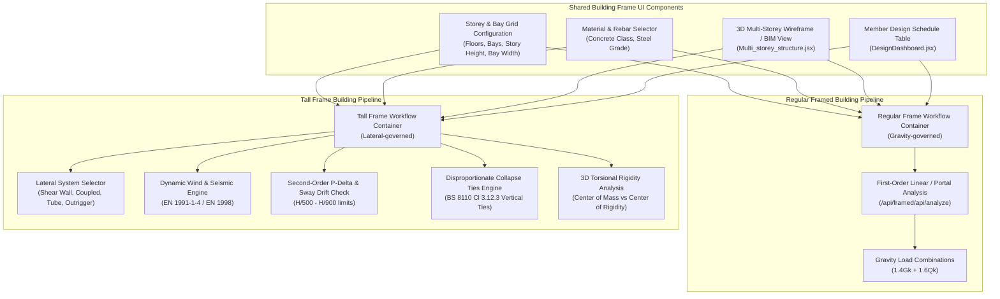

# Fundi Studio — UI Cleanup and Component Reuse Audit & Architecture Plan

**Branch:** `feature/cad-bim-ifc-integration`  
**Repository:** `C:\Users\HP\Documents\programming\Java script\ReactApps\Services`  
**Audit Baseline:** `docs/FUNDI_STUDIO_UI_ARCHITECTURE_AUDIT.md`  
**Execution Type:** Pure static analysis, component audit, and engineering architecture planning.  
**Safety Confirmation:** Zero application source files modified, renamed, moved, or deleted.

---

## 1. Source-Verified Inventory of Inspected Workflows and Components

Every component, route, and file listed below was inspected directly in the current repository working tree.

```
┌─────────────────────────────────────────────────────────────────────────────────────────────────┐
│                                       APPLICATION SHELL                                         │
│  src/components/engineering_appp.jsx (AppLayout, Router, Navigation, Chat Overlay, Theme)       │
│  src/components/components/Sidebar.jsx (Left Navigation Drawer)                                 │
│  src/components/components/RightSidebar.jsx (Settings Drawer)                                   │
│  src/components/components/ChatPage.jsx (Home Directory, Tool Search, 34 Category Launchers)    │
└─────────────────────────────────────────────────────────────────────────────────────────────────┘
         │                                       │                                     │
         ▼                                       ▼                                     ▼
┌─────────────────────────┐           ┌─────────────────────────┐           ┌──────────────────────┐
│  STRUCTURAL ENGINEERING │           │   QUANTITY SURVEYING    │           │  SURVEYING & GEOTECH │
│  • Beams                │           │  • Roof Works           │           │  • Surveying App     │
│  • Slabs                │           │  • Septic System        │           │  • Geoid & GNSS      │
│  • Columns              │           │  • Drainage / Manholes  │           │  • Earthworks        │
│  • Stairs               │           │  • External Works       │           │  • Route Surveying   │
│  • Foundations          │           │  • Substructure         │           │  • Soil Mechanics    │
│  • Walls                │           │  • Superstructure       │           └──────────────────────┘
│  • Retaining Walls      │           │  • Taking-Off Sheet     │                      │
│  • Regular Framed       │           │  • Dimension Paper      │                      ▼
│  • Tall Frame System    │           │  • Bill of Quantities   │           ┌──────────────────────┐
│  • Steel Design         │           └─────────────────────────┘           │   CAD / BIM / IFC    │
│  • Timber Design        │                                                 │  • Konva 2D Drawer   │
│  • Masonry Design       │                                                 │  • R3F Visualiser    │
└─────────────────────────┘                                                 │  • Interop Workbench │
                                                                            │    (MLightCAD+webifc)│
                                                                            └──────────────────────┘
```

### 1.1 Structural Engineering Workflows

| Engineering Module | Key Components & Files | Route | Calculation Method / Standards | Visual & CAD Output |
|---|---|---|---|---|
| **RC Beams** | `StructuralEngineeeringSuite.jsx`<br>`RCBeamDesigner.jsx`<br>`Eurocode_beam.jsx`<br>`Three.jsx`, `distribution.jsx` | `/structural/manual/beam` | BS 8110-1:1997 (Three-Moment, Moment Distribution, Table 3.5)<br>Eurocode 2 EN 1992-1-1 | 2D section (`BeamDrawer.jsx`)<br>3D rebar cage (`Beam_THree.jsx`)<br>DXF export (`/api/export-dxf`) |
| **RC Slabs** | `main_slab_app.jsx`<br>`slab_calculator_frontend.jsx`<br>`eurocode_slab_calculator.jsx` | `/structural/manual/slabs` | BS 8110 (One-way, two-way, ribbed, waffle)<br>Eurocode 2 | 2D plan (`SlabDrawer.jsx`)<br>3D slab model (`slab_THReeD.jsx`) |
| **RC Columns** | `Columnmain.jsx`<br>`ColumnDrawer.jsx` | `/structural/manual/column` | BS 8110 Uniaxial & Biaxial interaction ($M_x, M_y, N$) | Recharts P-M interaction curve<br>3D column view (`column_3d_helper.jsx`) |
| **RC Stairs** | `stair_main_app.jsx`<br>`Stair2D.jsx` | `/structural/manual/stairs` | BS 8110 / Eurocode 2 doglegged flights, waist, landings | 2D profile & rebar detailing<br>3D stair viewer (`visualisation_helper.jsx`) |
| **RC Foundations** | `foundation_main_app.jsx`<br>`BsCodes.jsx`<br>`eurocode_foundation_app.jsx` | `/structural/manual/foundation` | BS 8110 / BS 8004 (Pad, combined, pile caps, strip footings)<br>Eurocode 7 | 2D foundation plan & section<br>DXF export (`/api/export-foundation-dxf`) |
| **RC Walls** | `main_wall_app.jsx`<br>`eurocode_wall_calc.jsx`<br>`Wall_visualiser.jsx` | `/structural/manual/wall` | BS 8110 / Eurocode 2 shear walls and bearing walls | 2D wall reinforcement elevation<br>DXF export (`/api/export-wall-dxf`) |
| **RC Retaining Walls** | `main_app_component.jsx`<br>`eurocode_retaining_calc.jsx` | `/structural/manual/retaining` | BS 8002 / Eurocode 7 cantilever and gravity walls | 2D earth pressure & stability diagram<br>3D retaining wall view |
| **Regular Framed Buildings** | `eurocode_structural_app.jsx`<br>`rc_structural_design.jsx`<br>`InteractiveStructureBuilder.jsx` | `/structural/manual/eurocode_structural_app` | BS 8110 / EN 1992 multi-bay, multi-storey linear elastic frame, gravity-governed | 2D structural grid canvas<br>3D frame mesh (`Multi_storey_structure.jsx`)<br>Member design dashboard |
| **Tall Frame Buildings** | `rc_structural_design.jsx` (`activeModule='systems'\|'modeling'`)<br>`tall_framed_backend.py` | `/structural/manual/eurocode_structural_app` | BS 8110 / BS 6399 / EN 1991-1-4 (Wind), EN 1998 (Seismic)<br>Second-order $P$-$\Delta$, sway stability, drift, robustness ties | Lateral drift curves, wind pressure profile, 3D building shear core view |
| **Steel Design** | `steel_design_app.jsx`<br>`bolted_connections_frontend.jsx`<br>`welded_joints_frontend.jsx`<br>`SteelBIM.jsx` | `/structural/manual/steel`<br>`/structural/automatic/bolt_connections`<br>`/structural/automatic/weld_connections` | BS 5950-1:2000 Universal Beams, Universal Columns, Ordinary/HSFG bolts, Fillet/butt welds | 2D steel section (`SteelSectionKonva.jsx`)<br>3D steel framing BIM viewer (`SteelStructure3D.jsx`) |
| **Timber Design** | `Timber_ui.jsx`<br>`Timber_visualisation.jsx` | `/structural/manual/Timber_design` | BS 5268-2:2002 Permissible stress design (Flexure, Axial, Combined, Stud wall) | 2D blueprint Konva canvas (grain hatching, neutral axis, dimensioned leader ticks) |
| **Masonry Design** | `Masonry_ui.jsx`<br>`masonry_visualiser.jsx` | `/structural/manual/Masonry_design` | BS 5628-1:2005 Unreinforced masonry (Vertical load resistance, Lateral panel flexure) | 2D masonry wall coursing elevation<br>Stress utilization gauges |

### 1.2 Quantity Surveying Workflows

| QS Module | Key Components & Files | Route | Pipeline Nature | Output Documents |
|---|---|---|---|---|
| **Roof Works** | `RoofMain.jsx`<br>`RoofForm.jsx`<br>`Roof3DVisualizer.jsx` | `/quantity/manual/roof-taking-off` | Initial geometry inputs $\to$ Backend SMM7 takeoff $\to$ Editable taking-off $\to$ Dimension paper $\to$ BOQ | SMM7 Taking-Off Sheet<br>Standard Dimension Paper<br>Priced Bill of Quantities |
| **Septic Tank** | `septik_tank.jsx`<br>`TwoD.jsx`<br>`ThreeD.jsx` | `/quantity/manual/septic-taking-off` | Tank/manhole/soakpit form $\to$ Backend quantity calculation $\to$ Editable takeoff $\to$ Dimension paper $\to$ BOQ | 2D engineering drawings<br>3D model<br>SMM7 Takeoff & BOQ |
| **Measurement Documents** | `EnglishMethodTakeoffSheet.jsx`<br>`universal_component.jsx` (`UniversalSheet`, `UniversalBOQ`)<br>`DocumentViewer.jsx` | `/quantity/manual/taking-off`<br>`/quantity/manual/approximate`<br>`/quantity/manual/boq`<br>`/quantity/manual/documents` | Downstream measurement document chain (Shared across all QS tools) | Professional English Method Takeoff Paper with timesing, squaring, descriptions, and summary BOQ |

### 1.3 Surveying & Geotechnical Workflows

| Tool | Component & File | Route | Capabilities |
|---|---|---|---|
| **Civil Surveying Suite** | `surveying_app.jsx` | `/surveying` | Levelling (Rise & Fall, Collimation), Traverse (Bowditch adjustment), Tacheometry, Sewer gradient, Control survey, Tape corrections |
| **Earthworks QS** | `erathworks.jsx` | `/surveying/earthworks` | Cross-section station chainages, cut/fill end areas, prismoidal volume, mass-haul balances |
| **Geoid & GNSS** | `geoid_model.jsx` | `/surveying/geoid-model` | Ellipsoidal to orthometric height transformations, undulation lookup |
| **Route Surveying** | `main_road.jsx` | `/surveying/road-railway` | Horizontal circular curves, transition spirals, vertical parabolic curves, superelevation |
| **Contouring & Terrain** | `Contouring_terrain.jsx` | `/surveying/contouring` | Point cloud triangulation, Delaunay TIN mesh, digital elevation contouring |
| **Deformation Monitoring**| `monitoring_deformation.jsx` | `/surveying/monitoring` | Multi-epoch target displacement vectors, settlement trendlines, velocity alerts |
| **Soil Mechanics Module** | `soil_mechanics.jsx` | `/surveying/soil-mechanics` | Phase relations, Atterberg limits, Proctor compaction, Direct shear/triaxial, Terzaghi/Meyerhof bearing capacity, 1D consolidation, Bishop slope stability, 3D borehole log |

### 1.4 CAD / BIM / Visualization Layer

| Tool / Route | Component & File | Underlying Engine | State & Integration |
|---|---|---|---|
| **CAD / BIM / IFC Workbench** | `InteropWorkbench.jsx`<br>`CadDxfViewer.jsx`<br>`ThatOpenBimViewer.jsx`<br>`IfcBimViewer.jsx` | `@mlightcad/*` 1.7.5<br>`web-ifc` 0.0.78<br>`@thatopen/*` 3.3.3<br>Python `IfcOpenShell` + `ezdxf` | Authoritative engineering model $\leftrightarrow$ DXF $\leftrightarrow$ IFC4 with SQLite persistent element mapping (`mapping.py`) |
| **2D Universal CAD Drawer** | `cad_drawing.jsx` | React Konva 10.0.12<br>`CadEngine.js` | In-memory 2D vector drafting canvas (lines, polylines, circles, rectangles, layers, snap engine) |
| **3D Procedural Visualizer** | `visualise_component.jsx` | React Three Fiber 9.4<br>`@react-three/drei` 10.7.6 | R3F procedural mesh scene renderer used for real-time 3D feedback across 30+ components |

---

## 2. Current-State Duplication & Maintainability Assessment

### 2.1 Duplication Hotspots

```
               REPEATED CODE & PATTERN DUPLICATION IN CURRENT SOURCE
┌─────────────────────────────────┬────────────────────────────────────────────────────────┐
│ UI Pattern                      │ Locations Re-Implemented Independently                 │
├─────────────────────────────────┼────────────────────────────────────────────────────────┤
│ Design Code Standard Switcher   │ • StructuralEngineeeringSuite.jsx (BS 8110 / Eurocode) │
│                                 │ • main_slab_app.jsx (BS 8110 / Eurocode)               │
│                                 │ • Columnmain.jsx                                       │
│                                 │ • stair_main_app.jsx (BS 8110 / Eurocode)              │
│                                 │ • foundation_main_app.jsx (BS Standards / Eurocode)    │
│                                 │ • main_wall_app.jsx (BS Codes / Eurocode)              │
│                                 │ • main_app_component.jsx (BS 8002 / Eurocode 7)        │
│                                 │ • eurocode_structural_app.jsx (BS Codes / Eurocodes)   │
├─────────────────────────────────┼────────────────────────────────────────────────────────┤
│ Dimensional Numeric Field       │ • Re-implemented >150 times with inline <label>       │
│ with Units                      │   and <input type="number"> with manual styling        │
│                                 │ • Timber_ui.jsx uses custom <Field> inline styles      │
│                                 │ • Masonry_ui.jsx uses custom <Input> text-[10px] mono  │
│                                 │ • septik_tank.jsx uses custom <InputField>             │
│                                 │ • steel_design_app.jsx uses colored border inputs      │
├─────────────────────────────────┼────────────────────────────────────────────────────────┤
│ Compliance Status Badge &       │ • RCBeamDesigner.jsx: StatusBadge & Summary Alert      │
│ Utilization Progress Bar        │ • Timber_ui.jsx: UtilBar & Badge (PASS/FAIL)           │
│                                 │ • Masonry_ui.jsx: Gauge & PassBadge                    │
│                                 │ • DesignDashboard.jsx: Member table progress bar       │
│                                 │ • steel_design_app.jsx: Inline text utilization %      │
├─────────────────────────────────┼────────────────────────────────────────────────────────┤
│ 3D/2D Viewer Modal Overlay      │ • RCBeamDesigner.jsx (Canvas, OrbitControls, Stage)    │
│                                 │ • Eurocode_beam.jsx (Canvas, Stage, Controls)          │
│                                 │ • septik_tank.jsx (UniversalTabs modal)                │
│                                 │ • RoofMain.jsx (UniversalTabs modal)                   │
│                                 │ • New_frame.jsx (Modal overlay & full-screen button)   │
└─────────────────────────────────┴────────────────────────────────────────────────────────┘
```

### 2.2 Styling System Inconsistencies
1. **Conflicting Styling Dialects:**
   - Most modules use Tailwind CSS utility classes (`bg-slate-800 text-white rounded-xl shadow-md`).
   - `Timber_ui.jsx` bypasses Tailwind almost entirely, using raw React inline style objects (`style={{ display: "flex", flexDirection: "column", gap: 4 }}`) with a dynamic design token function `getTokens(isDark)`.
   - `Masonry_ui.jsx` uses a custom monospace technical blueprint styling with microscopic uppercase labels (`text-[10px] font-mono tracking-widest uppercase`).
   - `DesignDashboard.jsx` uses plain JavaScript style constants (`const modalStyle = { ... }`).
2. **Inconsistent Theming:**
   - Some components accept `isDark` (boolean).
   - Some components accept `theme` (string `"dark"` | `"light"`).
   - Some components ignore theme props completely (e.g. `DimensionsApp`, `MaterialsApp`).

---

## 3. Dedicated Comparison: Tall Frame vs. Regular Framed Buildings

The repository contains two intertwined representations under `src/components/ReinforcedConcrete/FramedandTall/`:
1. **Regular Framed Buildings:** Traditional low-to-mid-rise moment-resisting concrete frame governed by gravity loading ($1.4 G_k + 1.6 Q_k$) and standard lateral wind shear.
2. **Tall Frame Buildings:** High-rise structures governed by lateral stiffness, wind acceleration profiles, seismic ductility, second-order sway ($P$-$\Delta$), inter-story drift limits, and disproportionate collapse robustness ties.

### 3.1 Comprehensive Engineering & Architecture Comparison Table

| Dimension | Regular Framed Buildings | Tall Frame Buildings | Comparison & Boundaries |
|---|---|---|---|
| **Height & Slenderness** | Height $H \le 25\text{ m}$ (typically 1–7 storeys); aspect ratio $H/B < 3$. | Height $H > 25\text{ m}$ up to $300\text{ m}$ (8–80+ storeys); aspect ratio $H/B \ge 3\dots 7$ (slender, wind-critical). | **Distinct engineering scope.** Height triggers structural system transitions. |
| **Governing Actions & Load Combinations** | Gravity loads govern: $1.4 G_k + 1.6 Q_k$. Lateral wind is treated as a static equivalent shear force distributed uniformly or trapezoidally. | Lateral loads govern (wind & seismic). Wind pressure varies with height $z$ per EN 1991-1-4 (terrain category 0–IV, orography factor $c_o$, turbulence $I_v(z)$, dynamic gust factor $c_s c_d$). Seismic response spectrum per EN 1998-1. | **Different load generators.** Tall frame requires dynamic wind profiles and seismic mass participation. |
| **Global Sway & Lateral Stability** | First-order linear elastic analysis. Sway is small and second-order effects are neglected ($\theta \le 0.10$). | **Second-order $P$-$\Delta$ (global building sway) and $P$-$\delta$ (member curvature) are mandatory.** Sway sensitivity index $\theta = \frac{P_{tot} \cdot d_r}{V_{tot} \cdot h}$. Lateral drift limits enforced strictly: $H/500$ down to $H/900$. | **Different analysis engines.** Regular frames cannot use linear analysis once $P$-$\Delta$ amplifies moments by $>10\%$. |
| **Structural System Typologies** | Rigid moment-resisting frames (beams + columns rigidly connected). | Specialized high-rise lateral resisting systems (`rc_structural_design.jsx:206-245`):<br>• Rigid frame ($\le 25\text{ m}$)<br>• Braced frame ($\le 50\text{ m}$)<br>• Shear wall core ($\le 70\text{ m}$)<br>• Coupled shear walls ($\le 100\text{ m}$)<br>• Framed tube ($\le 150\text{ m}$)<br>• Tube-in-tube ($\le 200\text{ m}$)<br>• Outrigger & mega-columns ($\le 300\text{ m}$) | **Unique to Tall Frame.** A regular framed workflow has no concept of outriggers, belt trusses, or framed tube shear lag. |
| **Robustness & Progressive Collapse Ties** | Standard BS 8110 Clause 3.12.3: Peripheral ties ($T_p = 60\text{ kN}$ or $20 + 4n_s$) and internal horizontal ties. | Rigorous structural integrity ties per BS 8110 / EN 1991-1-7 (`tall_framed_backend.py:33-48`):<br>• Peripheral ties<br>• Internal ties ($F_t = \min(60, 20 + 4n_s)$)<br>• Horizontal column/wall ties ($2\%\text{ of } N_{Ed}$ or $F_t$)<br>• Vertical ties continuous through all storeys to bridge failed load-bearing members. | **Shared formula base, but Tall Frame enforces vertical tie continuity and element removal bridging checks.** |
| **3D Computer Modeling & Torsional Coupling** | Symmetric, 2D planar bent frame approximation (Portal method or Cantilever method). | Multi-bent 3D spatial analysis (`tall_framed_backend.py:85-100`):<br>• Category 1: Identical parallel bents<br>• Category 2: Stiffness-weighted distribution<br>• Category 3: Full 3D torsional analysis accounting for eccentricity $e_x, e_y$ between Center of Mass (CM) and Center of Rigidity (CR). | **Distinct analysis model.** Regular frame assumes no diaphragm rotation; tall frame requires center of rigidity calculations. |
| **Member Design Outputs** | Individual member sizing: Beams (flexure, shear, deflection), Columns (axial + bending), Slabs, Footings. | Global building drift envelope + member design dashboard + member utilization table across multiple storeys and elevation groups. | **Shared member design components, different data hierarchy.** Regular frame designs one beam; tall frame designs floor-grouped schedules. |
| **Backend Contracts & Endpoints** | Shares `/api/framed/api/design/beam`, `/api/framed/api/design/column`, `/api/framed/api/design/slab`. | Tall Frame exclusively calls:<br>`POST /api/framed/api/analysis/structural-system`<br>`POST /api/framed/api/analysis/computer-model`<br>`POST /api/framed/api/analysis/wind-load`<br>`POST /api/framed/api/analysis/seismic`<br>`POST /api/framed/api/design/ties` | **Distinct API endpoints.** |
| **Duplicated UI Code in Repository** | Both re-implement storey/bay count inputs, grid dimensional inputs, concrete grade selectors, and member schedule tables. | Both re-implement storey/bay count inputs, grid dimensional inputs, concrete grade selectors, and member schedule tables. | **High UI duplication.** The grid setup, material selection, and 3D wireframe viewers can be shared. |

### 3.2 Architectural Boundary: How to Share UI Without Conflating Engineering Logic



**Key Architectural Rule:**
- **Shared:** The visual grid setup, material dropdowns, 3D structural canvas ([`Multi_storey_structure.jsx`](file:///c:/Users/HP/Documents/programming/Java%20script/ReactApps/Services/src/components/ReinforcedConcrete/FramedandTall/Multi_storey_structure.jsx)), and the multi-member result dashboard ([`DesignDashboard.jsx`](file:///c:/Users/HP/Documents/programming/Java%20script/ReactApps/Services/src/components/ReinforcedConcrete/FramedandTall/DesignDashboard.jsx)) should be extracted into reusable frame components.
- **Strictly Separated:** The Tall Frame workflow container must retain its own configuration stages for structural system selection (Tube, Outrigger, Coupled Core), dynamic wind profiling, seismic response spectra, $P$-$\Delta$ drift verification, and robustness tie calculations. It must never be compressed into a generic portal frame input.

---

## 4. Proposed Shared-Component Catalogue with Interfaces & Boundaries

To clean up duplication without breaking workflows, components are organized into four strict layers:

```
┌────────────────────────────────────────────────────────────────────────┐
│ Layer 4: Engineering Logic & Integrations                              │
│ • Deterministic Handbooks • API Clients • CAD/IFC Serializers          │
└──────────────────────────────────▲─────────────────────────────────────┘
                                   │
┌──────────────────────────────────┴─────────────────────────────────────┐
│ Layer 3: Workflow-Specific Forms                                       │
│ • RCBeamDesigner • TallFrameContainer • RoofMain • SepticApp           │
└──────────────────────────────────▲─────────────────────────────────────┘
                                   │
┌──────────────────────────────────┴─────────────────────────────────────┐
│ Layer 2: Reusable Engineering Form Components                          │
│ • MaterialGradeSelector • ExposureCoverGroup • SectionDimensionInput   │
└──────────────────────────────────▲─────────────────────────────────────┘
                                   │
┌──────────────────────────────────┴─────────────────────────────────────┐
│ Layer 1: Shared UI Primitives                                          │
│ • EngineeringField • DesignCodeToggle • StatusBadge • ViewerModal      │
└────────────────────────────────────────────────────────────────────────┘
```

---

### Layer 1: Shared UI Primitives (`src/components/shared/primitives/`)

#### 1. `EngineeringField`
- **Purpose:** A standardized wrapper for all engineering inputs that renders the field label, standard engineering unit adornment, tooltip help text, and validation/error message.
- **Proposed Interface:**
```typescript
interface EngineeringFieldProps {
  label: string;
  unit?: string;               // e.g. "mm", "kN", "kN/m²", "MPa", "m"
  tooltip?: string;            // Reference clause or explanation
  error?: string | null;       // Validation error string
  warning?: string | null;     // Code limit warning
  required?: boolean;
  isDark?: boolean;
  children: React.ReactNode;   // The underlying input or select control
  className?: string;
}
```
- **Workflows Replaced:** Raw `<label>` and `<input>` wrappers in Beam, Slab, Column, Steel, Timber, Masonry, and Septic forms.

#### 2. `EngineeringNumberInput`
- **Purpose:** A controlled numeric input with automatic numeric parsing (`parseFloat`), min/max clamping, precision step controls, and prevention of negative values when disallowed.
- **Proposed Interface:**
```typescript
interface EngineeringNumberInputProps {
  value: number | string;
  onChange: (value: number) => void;
  min?: number;
  max?: number;
  step?: number | string;
  placeholder?: string;
  disabled?: boolean;
  isDark?: boolean;
  id?: string;
}
```

#### 3. `DesignCodeToggle`
- **Purpose:** Standardized segmented button or toggle for switching between engineering design standards (e.g. BS 8110 vs. Eurocode 2, BS 5950 vs. Eurocode 3, BS 8002 vs. Eurocode 7).
- **Proposed Interface:**
```typescript
interface DesignCodeToggleProps {
  activeCode: string;
  onChange: (code: string) => void;
  options: Array<{
    id: string;
    label: string;
    sublabel?: string;         // e.g. "BS 8110-1:1997" or "EN 1992-1-1"
    icon?: React.ComponentType<{ size?: number; className?: string }>;
  }>;
  isDark?: boolean;
}
```
- **Replaces:** 7 conflicting ad-hoc toggle implementations across Beam, Slab, Column, Stairs, Walls, Foundations, and Framed suites.

#### 4. `StatusBadge` & `UtilizationGauge`
- **Purpose:** Unified visualization of engineering check outcomes (PASS / FAIL / WARNING) and structural utilization percentage bars with standardized color bands ($<50\%$ normal green, $50-90\%$ optimal amber, $>90\%$ critical red).
- **Proposed Interface:**
```typescript
interface StatusBadgeProps {
  status: 'PASS' | 'FAIL' | 'WARNING';
  label?: string;
  size?: 'sm' | 'md' | 'lg';
  isDark?: boolean;
}

interface UtilizationGaugeProps {
  ratio: number;               // Value between 0.0 and 2.0 (1.0 = 100% capacity)
  label: string;               // e.g. "Bending M_Ed / M_Rd"
  allowable?: number;          // Default 1.0
  isDark?: boolean;
}
```

#### 5. `ViewerModal`
- **Purpose:** Standard full-screen and dialog container for 2D and 3D canvases, providing standardized header controls, close button, view mode toggles (Top, Elevation, Isometric), reset camera button, and canvas resize listener.
- **Proposed Interface:**
```typescript
interface ViewerModalProps {
  isOpen: boolean;
  onClose: () => void;
  title: string;
  subtitle?: string;
  actions?: React.ReactNode;   // e.g. Export CAD, Download PDF
  isDark?: boolean;
  children: React.ReactNode;   // The Three.js Canvas or Konva Stage
}
```

---

### Layer 2: Reusable Engineering Form Components (`src/components/shared/engineering/`)

#### 1. `MaterialGradeSelector`
- **Purpose:** Standardized concrete cube/cylinder compressive strength ($f_{cu} / f_{ck}$), rebar characteristic yield strength ($f_y / f_{yk}$), structural steel grade ($S275, S355, S450$), and timber strength classes ($C14\dots D70$).
- **Configuration Prop:** `materialType: 'concrete' | 'rebar' | 'steel' | 'timber' | 'masonry'`.
- **Outputs:** Grade key and design strength constants ($f_{cd}, f_{yd}, E_s$).

#### 2. `ExposureAndCoverGroup`
- **Purpose:** Unified section for durability classification (Mild, Moderate, Severe, Very Severe, Extreme; XC1–XC4, XD1–XD3, XS1–XS3), fire resistance rating (30 mins to 4 hours), and nominal concrete cover $c_{nom}$.
- **Outputs:** `{ exposureClass, fireRatingHours, coverMm }`.

#### 3. `StoreyGridSetup`
- **Purpose:** Standardized setup for building frame geometry: number of storeys, number of bays along X/Y, storey heights, bay widths, and bay spacings.
- **Used by:** Both Regular Framed Buildings and Tall Frame Buildings.

---

### Layer 3: Workflow-Specific Forms (Preserved Domain Containers)
These remain independent components containing domain-specific fields and workflow state:
- `RCBeamDesigner`: Span configurations, flanged section ratios, rebar layer distribution.
- `RCSlabModule`: Edge continuity matrix, span ratios ($l_y / l_x$), rib topping dimensions.
- `TallFrameContainer`: Lateral structural system choice (Tube, Outrigger, Shear Core), EN 1991 wind profile, seismic acceleration response spectrum, drift limit threshold, robustness vertical ties.
- `RoofTakeoffForm`: Roof typology (Gable, Hipped, Gambrel, Mansard), upper/lower pitch angles, truss spacings, covering materials.
- `SepticTakeoffForm`: Chamber dimensions, baffle wall heights, manholes, soak pit shapes.

---

### Layer 4: Engineering Logic & Integrations (Non-Visual)
- All calculation functions, FastAPI endpoints, and CAD/BIM serialization scripts remain in their current backend/engine modules.
- UI components communicate through thin, strongly-typed adapter functions.

---

## 5. Workflow-to-Component Reuse Matrix

| Workflow | `EngineeringField` & `NumberInput` | `DesignCodeToggle` | `MaterialGradeSelector` | `ExposureAndCoverGroup` | `StatusBadge` & `UtilizationGauge` | `ViewerModal` | `StoreyGridSetup` | Workflow-Specific Component (Preserved) |
|---|:---:|:---:|:---:|:---:|:---:|:---:|:---:|---|
| **RC Beam** | Yes | Yes | Yes (Concrete + Rebar) | Yes | Yes | Yes | - | `RCBeamDesigner.jsx` |
| **RC Slabs** | Yes | Yes | Yes (Concrete + Rebar) | Yes | Yes | Yes | - | `slab_calculator_frontend.jsx` |
| **RC Columns** | Yes | Yes | Yes (Concrete + Rebar) | Yes | Yes | Yes | - | `Columnmain.jsx` |
| **RC Stairs** | Yes | Yes | Yes (Concrete + Rebar) | Yes | Yes | Yes | - | `stair_main_app.jsx` |
| **RC Foundations**| Yes | Yes | Yes (Concrete + Rebar) | Yes | Yes | Yes | - | `foundation_main_app.jsx` |
| **RC Walls** | Yes | Yes | Yes (Concrete + Rebar) | Yes | Yes | Yes | - | `main_wall_app.jsx` |
| **RC Retaining** | Yes | Yes | Yes (Concrete + Rebar) | Yes | Yes | Yes | - | `main_app_component.jsx` |
| **Regular Framed**| Yes | Yes | Yes (Concrete + Rebar) | Yes | Yes | Yes | Yes | `InteractiveStructureBuilder.jsx` |
| **Tall Frame** | Yes | Yes | Yes (Concrete + Rebar) | Yes | Yes | Yes | Yes | `TallFrameLateralSystem.jsx`, `WindProfile.jsx`, `TiesModule.jsx` |
| **Steel Design** | Yes | Yes | Yes (Steel S275/355) | - | Yes | Yes | - | `steel_design_app.jsx`, `bolted_connections_frontend.jsx` |
| **Timber Design**| Yes | - | Yes (Timber C14-D70) | - | Yes | - | - | `Timber_ui.jsx`, `Timber_visualisation.jsx` |
| **Masonry Design**| Yes | - | Yes (Mortar/Bricks) | - | Yes | - | - | `Masonry_ui.jsx`, `masonry_visualiser.jsx` |
| **Roof Takeoff** | Yes | - | - | - | - | Yes | - | `RoofForm.jsx`, `EnglishMethodTakeoffSheet.jsx` |
| **Septic Takeoff**| Yes | - | - | - | - | Yes | - | `septik_tank.jsx`, `EnglishMethodTakeoffSheet.jsx` |
| **Civil Survey** | Yes | - | - | - | Yes | - | - | `surveying_app.jsx` |
| **Soil Mechanics**| Yes | - | - | - | Yes | Yes | - | `soil_mechanics.jsx` |

---

## 6. Components and Logic That Must Deliberately Remain Separate

To protect the integrity of the application, the following must **never** be merged or forced into a generic abstraction:

1. **Downstream Quantity Surveying Measurement Documents:**
   - [`EnglishMethodTakeoffSheet.jsx`](file:///c:/Users/HP/Documents/programming/Java%20script/ReactApps/Services/src/components/takeoff2/ExternalWorks/EnglishMethodTakeoffSheet.jsx), [`UniversalSheet`](file:///c:/Users/HP/Documents/programming/Java%20script/ReactApps/Services/src/components/takeoff2/universal_component.jsx), and [`UniversalBOQ`](file:///c:/Users/HP/Documents/programming/Java%20script/ReactApps/Services/src/components/takeoff2/universal_component.jsx) represent formal standard civil measurement conventions (SMM7 / CESMM4).
   - They must remain dedicated spreadsheet/dimension-paper documents. Do not replace them with generic dashboard cards or simplified tables.
2. **Tall Frame Lateral Analysis & Robustness Systems:**
   - The wind boundary layer velocity profile, seismic response spectra, inter-story drift equations, outrigger truss mechanics, and vertical tie load redistribution calculations in `rc_structural_design.jsx` and `tall_framed_backend.py` must remain exclusive to Tall Frame.
   - Do not merge them with the low-rise regular frame analysis.
3. **Engineering Calculation Code & Handbooks:**
   - All Python calculation routers (`src/Backend/calculations/*`) and deterministic JS calculations (e.g. BS 5950 steel formulas in `steel_design_app.jsx`) must stay untouched. UI cleanup is strictly confined to presentation components.
4. **CAD/BIM Interoperability Workbench:**
   - The `/interop/cad-bim` workbench ([`InteropWorkbench.jsx`](file:///c:/Users/HP/Documents/programming/Java%20script/ReactApps/Services/src/components/interop/InteropWorkbench.jsx)) provides a verified IFC4 / MLightCAD / That Open pipeline. It must not be mixed with or replaced by the legacy Konva 2D drawer ([`cad_drawing.jsx`](file:///c:/Users/HP/Documents/programming/Java%20script/ReactApps/Services/src/components/Drawings/cad_drawing.jsx)).

---

## 7. Staged Implementation Plan (Minimizing Regression Risk)

### Stage 1: Core UI Primitives & Design Code Toggle (Lowest Risk)
- **Objective:** Establish the foundational UI primitive components without touching existing engineering calculations.
- **Components to Introduce:**
  - `src/components/shared/primitives/EngineeringField.jsx`
  - `src/components/shared/primitives/EngineeringNumberInput.jsx`
  - `src/components/shared/primitives/DesignCodeToggle.jsx`
  - `src/components/shared/primitives/StatusBadge.jsx`
  - `src/components/shared/primitives/UtilizationGauge.jsx`
- **Pilot Workflow:**
  - Refactor `DesignCodeToggle` into `src/components/ReinforcedConcrete/Beams/StructuralEngineeeringSuite.jsx` (Beam) and `src/components/ReinforcedConcrete/Walls/main_wall_app.jsx` (Wall).
- **Verification:**
  - Verify that switching between BS 8110 and Eurocode 2 properly toggles views and triggers identical calculations with zero payload deviation.
- **Commit Boundary:** `feat(ui): add shared engineering primitives and pilot on beam/wall code switcher`.

---

### Stage 2: Shared Engineering Form Components (Materials & Durability)
- **Objective:** Consolidate concrete, steel, timber, and masonry grade selectors and exposure/cover field groups.
- **Components to Introduce:**
  - `src/components/shared/engineering/MaterialGradeSelector.jsx`
  - `src/components/shared/engineering/ExposureAndCoverGroup.jsx`
- **Workflows Affected:**
  - RC Beams (`StructuralEngineeeringSuite.jsx`), RC Slabs (`main_slab_app.jsx`), RC Columns (`Columnmain.jsx`), RC Foundations (`foundation_main_app.jsx`).
- **Verification:**
  - Check that material strength constants ($f_{cu}, f_{ck}, f_y, E_s$) passed to calculation APIs match previous values exactly.
- **Commit Boundary:** `feat(ui): extract reusable MaterialGradeSelector and ExposureAndCoverGroup`.

---

### Stage 3: Regular Framed vs. Tall Frame Component Decoupling
- **Objective:** Separate shared frame setup from tall-building lateral analysis while eliminating duplicated frame inputs.
- **Actions:**
  - Extract `StoreyGridSetup.jsx` (storeys, bays, heights, widths) and `MemberDesignDashboard.jsx` from `rc_structural_design.jsx` and `DesignDashboard.jsx`.
  - Mount `StoreyGridSetup` in Regular Framed Buildings and in Tall Frame Buildings.
  - Isolate Tall Frame's lateral systems (Shear Core, Outrigger, Tube-in-Tube), wind profiles, and vertical tie robustness into `TallFrameSpecifics.jsx`.
- **Verification:**
  - Submit 5-storey regular frame; verify linear analysis.
  - Submit 30-storey tall frame with wind/seismic and outrigger; verify drift, $P$-$\Delta$, and tie calculations match backend test suite.
- **Commit Boundary:** `refactor(structural): decouple shared frame grid from tall frame lateral systems`.

---

### Stage 4: Takeoff Initial Input Forms Modernization
- **Objective:** Clean up initial input forms for Roof and Septic tank using `EngineeringField` and `EngineeringNumberInput`, while strictly preserving the downstream Taking-off Sheet, Dimension Paper, and BOQ.
- **Components to Refactor:**
  - `src/components/takeoff2/RoofWorks/RoofForm.jsx`
  - `src/components/takeoff2/septik/septik_tank.jsx` (Chamber and Soakpit inputs)
- **Verification:**
  - Calculate Roof takeoff: verify generated items flatten into `EnglishMethodTakeoffSheet` identically.
  - Edit timesing and dimensions: verify auto-squaring in `UniversalSheet` and quantity/rate amounts in `UniversalBOQ` remain 100% consistent.
- **Commit Boundary:** `refactor(qs): standardize roof and septic initial forms while preserving document pipeline`.

---

### Stage 5: Viewer Dialog Unification & CAD Handshake Fix
- **Objective:** Unify 2D/3D modal viewers into `ViewerModal` and connect the broken "Send to CAD" button from RC Beam to the 2D CAD canvas.
- **Actions:**
  - Implement `src/components/shared/primitives/ViewerModal.jsx`.
  - In `src/components/Drawings/cad_drawing.jsx`, read `useLocation().state.config` and add primitives to `CadEngine`.
- **Verification:**
  - In RC Beam Designer, click "Send to CAD"; verify that `/drawing` opens and immediately renders the beam rebar cross-section on the Konva canvas.
- **Commit Boundary:** `fix(cad): connect RC beam send-to-cad navigation and standardize ViewerModal`.

---

## 8. Unresolved Questions & Assumptions That Could Not Be Verified

1. **Offline Qwen AI Service:**
   - In `src/Backend/main.py:286`, `qwen_model_router` is commented out. The cleanup plan assumes this service will eventually be restored on port 8001, but does not alter the backend.
2. **Port 8000 Endpoints:**
   - Soil mechanics (`soil_mechanics.jsx:8`) and the CAD copilot (`cad_drawing.jsx:1439`) point to port `8000`. It could not be verified whether an independent microservice was originally intended to run on port 8000 or whether this was a configuration typo for 8001.
3. **Unregistered CAD FastAPIs in `src/components/Cad_Dwg/`:**
   - The directory contains standalone Python FastAPI apps (`main.py` files). These are not referenced by `src/Backend/main.py` or the frontend routes and appear to be abandoned experimental spikes.
4. **`detailing_3d.jsx` Reachability:**
   - The 244 KB file `src/components/Drawings/detailing_3d.jsx` exports 21 detail generator functions, but has zero importers across `src/`. It is currently dead code.
5. **Downstream Takeoff Document State Sync:**
   - It is assumed that specialized takeoffs (Roof, Septic) are currently intended to be self-contained modules, and that publishing to the global `/quantity/manual/taking-off` route will be an opt-in future feature rather than a forced synchronization.
